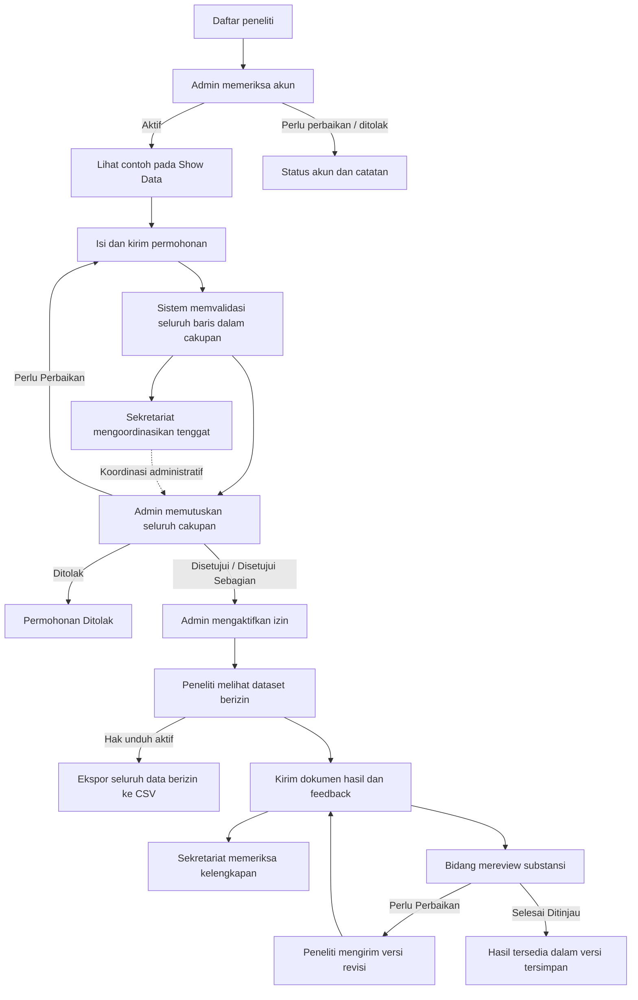

# Reverse PRD — Modul Penelitian SIAGA BPBD Kota Semarang

| Identitas | Keterangan |
| --- | --- |
| Versi dokumen | 1.1 — revisi kedua penelitian |
| Tanggal penyusunan | 31 Oktober 2026, WIB |
| Jenis | Dokumentasi fungsional berdasarkan implementasi yang tersedia |
| Cakupan | Layanan penelitian dan fungsi pendukung akun, izin, dokumen, serta pengingat |
| Dasar pemeriksaan | Kode pada working tree proyek `bpbd-web`; basis Git `277ea3e`, termasuk perubahan lokal yang belum dikomit |
| Pembaca | Tim penelitian, pengembang, penguji, Sekretariat, Admin, dan peninjau bidang |

## 1. Ringkasan produk

Modul Penelitian menyediakan layanan bagi peneliti untuk mendaftarkan akun, mengenali contoh dataset, mengajukan kebutuhan data, mengakses data sesuai keputusan BPBD, mengekspor CSV, serta menyerahkan hasil penelitian dan revisinya.

Sistem menghubungkan peneliti dengan tiga kelompok pengelola: Admin Sistem untuk akun, keputusan cakupan dan aktivasi izin; Sekretariat untuk koordinasi administrasi/tenggat; serta peninjau bidang untuk review hasil.

**Perilaku utama yang harus dibedakan:**

| Proses | Pelaksana | Hasil langsung |
| --- | --- | --- |
| Validasi baris saat pengajuan | Sistem | Referensi ID dan versi seluruh baris yang memenuhi cakupan dicatat otomatis |
| Persetujuan cakupan | Admin Sistem untuk seluruh dataset | Dataset disetujui seluruhnya, sebagian, ditolak, atau diminta diperbaiki |
| Aktivasi akses | Admin Sistem | Peneliti dapat membaca data sesuai izin dan, jika diizinkan, mengekspor CSV |

Revisi kedua memusatkan keputusan pada Admin Sistem. Pengajuan baru **tidak otomatis berstatus Disetujui**. Validasi otomatis juga tidak langsung mengaktifkan akses atau hak unduh. Permohonan contoh yang sudah disetujui seluruhnya merupakan data demonstrasi lokal, bukan perubahan aturan pengajuan.

### 1.1 Tujuan fungsional

- Menyediakan alur permohonan data penelitian dengan kepemilikan akun yang jelas.
- Menghubungkan kebutuhan data lintas bidang dengan keputusan Admin Sistem.
- Membatasi data berdasarkan dataset, wilayah, periode, status data operasional, dan validasi versinya.
- Memisahkan persetujuan permohonan, aktivasi izin, penerimaan hasil, pemeriksaan administrasi, dan review substansi.
- Menyimpan hasil penelitian sebagai dokumen berversi beserta ringkasan dan feedback.
- Menyiapkan pengingat tenggat penelitian melalui WhatsApp.

Tujuan tersebut disimpulkan dari alur dan fungsi yang diimplementasikan. Target peningkatan jumlah penelitian, SLA persetujuan, atau indikator keberhasilan organisasi belum didefinisikan dalam kode.

### 1.2 Batas lingkup

Termasuk: pendaftaran dan profil peneliti, persetujuan akun, Show Data, permohonan, validasi otomatis, keputusan Admin, izin, pratinjau dataset, ekspor CSV, perpanjangan tenggat hasil, pengiriman dokumen, review, riwayat, dan pengingat.

Di luar lingkup dokumen: dashboard operasional, pencatatan kegiatan, impor data, pembuatan laporan operasional, dan pengelolaan master umum. Data operasional hanya dibahas sebagai sumber data yang dapat diminta peneliti.

## 2. Sumber dan cara membaca dokumen

Dokumen disusun dengan menelusuri komponen UI, pemeriksaan hak akses, API, model data, penyimpanan, worker pengingat, dan sumber pengujian. Dokumentasi revisi dipakai sebagai konteks; kode menentukan perilaku yang dicatat.

| ID sumber | Lokasi | Bukti fungsional |
| --- | --- | --- |
| S01 | [research.tsx](../components/bpbd/research.tsx) | Beranda, contoh dataset, permohonan, keputusan, akses, ekspor, hasil |
| S02 | [auth.tsx](../components/bpbd/auth.tsx) | Pendaftaran, status akun, profil, persetujuan pengingat |
| S03 | [admin.tsx](../components/bpbd/admin.tsx) | Persetujuan akun dan penerapan izin penelitian |
| S04 | [app.tsx](../components/bpbd/app.tsx) | Navigasi, route, sesi UI, notifikasi, pemutakhiran data |
| S05 | [model.ts](../lib/bpbd/model.ts) | Role, dataset, cakupan, validasi versi, akses, tanggal acuan |
| S06 | [policy.ts](../lib/server/policy.ts) | Pembatasan data per aktor dan validasi perubahan di server |
| S07 | [api.ts server](../lib/server/api.ts) | Pendaftaran, sesi, penyimpanan, CSV, unggahan dan akses berkas |
| S08 | [files.ts](../lib/bpbd/files.ts) | Pembentukan CSV, unduhan, pemeriksaan dasar dokumen |
| S09 | [research-reminders.ts model](../lib/bpbd/research-reminders.ts) dan [worker](../scripts/research-reminders.ts) | Pemilihan penerima, jadwal mingguan, pengiriman dan deduplikasi |
| S10 | [schema.ts](../db/schema.ts) dan [repository.ts](../lib/server/repository.ts) | Entitas PostgreSQL, versi perubahan, penyimpanan dokumen |
| S11 | [Tes penelitian](../tests/research.test.mjs), [tes browser](../tests/browser/research.spec.ts), [tes integrasi](../tests/postgres.test.mjs) | Skenario perilaku yang sudah memiliki pengujian dalam repositori |

Istilah **tersedia** berarti alurnya ditemukan dalam kode. **Bersyarat** berarti membutuhkan konfigurasi atau proses terpisah. **Keterbatasan** berarti perilaku aktual belum mencakup kemampuan yang mungkin diasumsikan pembaca. Penyusunan dokumen ini tidak menjalankan ulang tes atau melakukan audit keamanan menyeluruh.

## 3. Aktor dan hak akses

| Aktor | Kode | Kewenangan dalam penelitian | Batasan utama |
| --- | --- | --- | --- |
| Calon peneliti | Belum login | Mendaftarkan akun dan masuk | Tidak dapat membuka layanan akun aktif |
| Peneliti belum aktif | PEN | Status akun, profil, bantuan; sesi tersedia untuk status tertentu | Tidak dapat mengajukan atau mengakses data penelitian |
| Peneliti aktif | PEN | Permohonan milik sendiri, contoh dataset, akses berizin, CSV, hasil, perpanjangan | Tidak dapat menyetujui cakupan atau mengaktifkan izin sendiri |
| Admin Sistem | ADM | Menyetujui akun, mengelola identitas peneliti, memutuskan seluruh cakupan permohonan, mengaktifkan/mengakhiri/mencabut izin | Tidak menjadi peninjau substansi hasil; memiliki halaman `/riset/permohonan` |
| Sekretariat | SEK | Koordinasi permohonan lintas bidang, tenggat, keputusan perpanjangan, pemeriksaan kelengkapan hasil | Tidak memutuskan persetujuan dataset milik bidang |
| Peninjau Pencegahan dan Kesiapsiagaan | PK | Review hasil permohonan terkait dataset PK | Memerlukan permission reviewer yang aktif |
| Peninjau Kedaruratan dan Logistik | KL | Review hasil permohonan terkait dataset KL | Hanya cakupan bidangnya |
| Peninjau Rehabilitasi dan Rekonstruksi | RR | Review hasil permohonan terkait dataset RR | Hanya cakupan bidangnya |

Permission reviewer PK/KL/RR dapat dinyalakan atau dimatikan melalui pengelolaan hak akses. Peneliti hanya menerima permohonan miliknya pada snapshot server. Sekretariat melihat permohonan lintas bidang; peninjau melihat permohonan yang meminta dataset bidangnya. [S03–S07]

## 4. Dataset yang dapat diminta

Form permohonan dan Show Data menyediakan 13 dataset berikut. Dua kelompok administrasi Sekretariat dalam model umum tidak disertakan dalam pilihan UI penelitian.

| Bidang | Dataset |
| --- | --- |
| KL | Kejadian Bencana; Korban dan Pengungsi; Kebutuhan Darurat; Stok dan Transaksi Logistik; Distribusi Bantuan |
| PK | Risiko dan Wilayah Rawan; Mitigasi Bencana; Edukasi dan Simulasi; Kajian Risiko |
| RR | Kerusakan Pascabencana; Kegiatan Pemulihan; Progres Rehabilitasi; Dokumentasi Pascabencana |

Dataset memakai model catatan bersama. Pratinjau menampilkan catatan, wilayah, tanggal, dan jumlah beserta satuannya. Belum ada struktur kolom khusus per dataset pada tampilan penelitian. [S01, S05]

## 5. Peta halaman

| Halaman / route | Pengguna | Fungsi utama |
| --- | --- | --- |
| `/daftar-peneliti` | Publik | Mengajukan akun penelitian |
| `/masuk` | Publik/pengguna | Login bersama; role ditentukan akun |
| `/status-akun` | PEN | Identitas, status, dan catatan pendaftaran |
| `/profil` | Akun yang diizinkan | Identitas, nomor telepon dan persetujuan WhatsApp untuk peneliti |
| `/peneliti` | PEN aktif | Ringkasan permohonan, akses, dan tindak lanjut hasil |
| `/peneliti/show-data` | PEN aktif | Lima contoh sintetis per dataset |
| `/peneliti/permohonan` | PEN aktif | Permohonan Data dan tombol Ajukan Permohonan |
| `/peneliti/permohonan/baru` | PEN aktif | Form permohonan baru |
| `/peneliti/permohonan/{id}` | Pemilik | Rincian permohonan dan jadwal/akses |
| `/peneliti/permohonan/{id}/edit` | Pemilik | Perbaikan Draf atau Perlu Perbaikan |
| `/peneliti/data` | PEN aktif | Tabel Data yang Disetujui; Buka rincian untuk data dan ekspor |
| `/peneliti/data/{id}` | Pemilik | Rincian Akses Data, cakupan dan ekspor |
| `/peneliti/hasil` | PEN aktif | Daftar hasil penelitian terkait cakupan yang disetujui |
| `/peneliti/hasil/kirim/{id}` | Pemilik | Unggah hasil atau versi revisi |
| `/peneliti/hasil/{id}` | Pemilik | Dokumen, ringkasan, feedback, review, versi dan riwayat |
| `/riset/permohonan` dan `/{id}` | ADM / SEK | Keputusan Admin atau koordinasi Sekretariat |
| `/riset/hasil` dan `/{id}` | SEK / reviewer terkait | Kelengkapan atau review substansi |
| `/admin/pendaftaran` | ADM | Pemeriksaan pendaftaran peneliti |
| `/admin/pengguna` dan `/{id}` | ADM | Identitas, kontak, status, dan pengelolaan akun |
| `/admin/akses-riset` | ADM | Penerapan izin berdasarkan keputusan Admin |

Urutan menu akun peneliti aktif: **Beranda Peneliti → Show Data → Permohonan Data → Data yang Disetujui → Hasil Penelitian**. Tombol Ajukan Permohonan tersedia pada daftar permohonan, bukan pada beranda. [S01–S04]

## 6. Alur menyeluruh

Koordinasi Sekretariat bukan prasyarat teknis wajib untuk tombol keputusan Admin. Pemeriksaan kelengkapan dan review substansi juga merupakan tindakan terpisah; implementasi tidak memaksakan urutan keduanya. [S01, S06]

## 7. Kebutuhan fungsional berdasarkan implementasi

### FR-PEN-01 — Pendaftaran, persetujuan akun, dan profil

**Prasyarat:** email belum terdaftar. **Pelaksana:** calon peneliti, Admin, lalu peneliti.

| Masukan | Ketentuan |
| --- | --- |
| Nama | Wajib; API maksimal 200 karakter |
| Email | Format email; maksimal 254 karakter; disimpan huruf kecil dan harus unik |
| Institusi | Wajib; API maksimal 300 karakter |
| Nomor telepon / WhatsApp | Wajib untuk pendaftaran baru; normalisasi nomor lokal berawalan 0 ke 62; hasil 10–15 digit |
| Tujuan penelitian | Wajib; API maksimal 5.000 karakter |
| Kata sandi | Minimal 8, maksimal 256 karakter di API |
| Persetujuan | Wajib; pernyataan pendaftaran mencakup kewajiban hasil dan pengingat WhatsApp |

Pendaftaran membuat role PEN dengan status **Menunggu Persetujuan**. Admin dapat menetapkan **Aktif**, **Perlu Perbaikan**, atau **Ditolak**; selain keputusan Aktif, UI meminta alasan. Akun juga dapat dinonaktifkan melalui pengelolaan pengguna.

Peneliti dapat mengubah nama, email, institusi, nomor telepon dan persetujuan WhatsApp pada profil. Normalisasi telepon hanya pemeriksaan format; tidak ada verifikasi OTP atau kepastian nomor terdaftar di WhatsApp. Akun lama dapat belum mempunyai nomor. [S02, S03, S06, S07]

### FR-PEN-02 — Beranda dan Show Data

Beranda menghitung permohonan milik akun, izin yang dinilai aktif, penelitian yang sudah memiliki versi hasil, dan penelitian dengan cakupan disetujui yang belum memiliki hasil. Panel Tindak lanjut mengarah ke pengiriman hasil dan hanya ditampilkan pada halaman Hasil Penelitian, bukan beranda.

Show Data menampilkan tepat lima contoh sintetis untuk setiap dataset pilihan penelitian. Contoh dibuat di frontend, tidak berasal dari pembacaan data operasional PostgreSQL, dan tidak memberi hak akses atau unduh data sebenarnya. [S01]

### FR-PEN-03 — Membuat draf dan mengajukan permohonan

**Prasyarat:** akun PEN Aktif. **Keluaran:** satu permohonan milik akun tersebut.

| Isian | Perilaku UI |
| --- | --- |
| Judul penelitian | Wajib dan tidak kosong |
| Institusi | Wajib; awalnya mengambil institusi akun |
| Tujuan/penggunaan data | Wajib |
| Wilayah | Satu kecamatan atau seluruh kecamatan |
| Periode data | Tanggal mulai dan akhir; mulai tidak boleh sesudah akhir |
| Rencana selesai penelitian | Wajib; UI menolak tanggal sebelum akhir periode data |
| Dataset | Minimal satu; dapat memilih beberapa bidang |
| Dokumen pendukung | Opsional, `.docx` atau PDF |
| Persetujuan kewajiban | Wajib pada form |

Pengguna menekan **Tinjau Permohonan**, melihat ringkasan, kemudian memilih **Simpan Draf** atau **Kirim Permohonan**. Karena Simpan Draf berada di modal ringkasan, UI saat ini tetap mengharuskan isian wajib dan persetujuan terpenuhi sebelum draf dapat disimpan.

Draf tidak menjalankan validasi otomatis. Kirim Permohonan menghasilkan status **Diajukan**, akses **Belum Aktif**, hak unduh `false`, dan keputusan persetujuan kosong. Draf maupun permohonan Perlu Perbaikan dapat diedit; pengajuan ulang mengosongkan keputusan sebelumnya dan menghitung ulang validasi. [S01, S06]

### FR-PEN-04 — Validasi seluruh baris secara otomatis

Server mencari seluruh catatan yang memenuhi semua syarat:

1. Dataset termasuk yang diminta.
2. Data operasional berstatus **Disetujui** dan tidak diarsipkan.
3. Kecamatan sesuai pilihan, kecuali pilihan seluruh kecamatan.
4. Tanggal catatan berada dalam periode inklusif mulai–akhir.

Server menyimpan waktu validasi dan pasangan ID–versi baris, lalu menambah riwayat dengan pelaksana **Sistem**. Validasi tidak dibatasi lima baris dan tidak memerlukan checkbox manual. Rincian permohonan menampilkan jumlah baris dan waktu validasi.

Validasi ini adalah pencatatan kecocokan cakupan dan versi data; bukan penilaian ilmiah, verifikasi kebenaran isi kejadian, atau persetujuan organisasi. Cakupan tanpa baris yang cocok dapat menghasilkan validasi berjumlah nol. [S01, S05, S06]

### FR-PEN-05 — Daftar, rincian, dan koordinasi permohonan

Daftar menyediakan pencarian judul, institusi, ID, dan nama peneliti yang tersedia pada konteks akun; filter status; reset; serta tabel berhalaman. Rincian peneliti menampilkan identitas penelitian, tujuan, wilayah/periode, dataset yang diminta, dokumen pendukung jika ada, hasil validasi otomatis, dan panel **Jadwal & akses**.

Tab **Cakupan & keputusan** dan **Riwayat** permohonan ditampilkan kepada pengelola internal, tidak pada rincian permohonan peneliti. Halaman hasil penelitian tetap mempunyai versi dan riwayat tersendiri.

Sekretariat dapat menetapkan tenggat hasil dan catatan koordinasi. Jika status semula Diajukan, penyimpanan koordinasi mengubahnya menjadi Dalam Peninjauan. [S01]

### FR-PEN-06 — Keputusan Admin dan persetujuan sebagian

Admin Sistem membuka **Permohonan Data**, memilih dataset lintas bidang yang akan disetujui, tanggal akhir izin, hak unduh, dan catatan. Tindakan: Setujui Cakupan, Minta Perbaikan, atau Tolak. Catatan wajib; persetujuan memerlukan minimal satu dataset yang termasuk dalam permohonan.

Server menyimpan satu keputusan ADM dan menghitung status: Disetujui jika semua dataset dipilih, Disetujui Sebagian jika hanya sebagian, Ditolak atau Perlu Perbaikan sesuai keputusan. Validasi baris diperbarui otomatis dari data terbaru. Bidang PK/KL/RR tidak dapat mengubah keputusan permohonan, termasuk melalui API; kewenangannya tetap review hasil.

Keputusan historis per bidang tetap dapat dibaca. Keputusan baru Admin menggantikan keputusan historis pada permohonan tersebut, termasuk cakupan, hak unduh, dan validasinya. Setiap perubahan keputusan mengembalikan akses ke Belum Aktif agar izin baru diaktifkan secara eksplisit. [S01, S05, S06]

### FR-PEN-07 — Aktivasi, pengakhiran, dan pencabutan izin

Admin membuka **Izin Data Peneliti**, memilih Kelola Izin pada permohonan Disetujui/Disetujui Sebagian, mengisi tanggal akhir akses dan catatan, lalu mengaktifkan, mengakhiri, atau mencabut izin. Aktivasi tetap tindakan terpisah dari keputusan.

Server memerlukan cakupan disetujui dan seluruh baris sesuai versi validasinya. Izin tidak boleh melampaui batas keputusan; hak unduh tidak boleh melampaui yang disetujui. Untuk permohonan historis tanpa keputusan ADM, aturan kompatibilitas keputusan bidang sebelumnya tetap digunakan. [S03, S05, S06]

### FR-PEN-08 — Membaca data yang disetujui

Permohonan dengan minimal satu dataset disetujui tercantum pada Data yang Disetujui, termasuk yang izinnya belum aktif. Isi data hanya tersedia jika akun pemilik Aktif, izin dinilai Aktif, keputusan Admin tersedia (atau keputusan historis bidang lengkap), dan validasi versi seluruh baris masih berlaku.

Setiap dataset yang disetujui memiliki pratinjau maksimal lima baris; jumlah sebenarnya dapat kurang dari lima atau nol. Dataset yang ditolak tidak ditampilkan sebagai data berizin. Peneliti tidak memperoleh lampiran operasional, deskripsi lengkap, relasi catatan, atau riwayat operasional pada snapshot datanya.

Jika satu baris berubah versi atau ada baris baru yang memenuhi cakupan setelah persetujuan, pemeriksaan validasi keseluruhan gagal. Implementasi menahan seluruh baris pada permohonan tersebut sampai persetujuan diperbarui, bukan sekadar menyembunyikan baris yang berubah. [S01, S05, S06]

### FR-PEN-09 — Ekspor CSV

Tombol **Ekspor CSV** hanya tersedia pada Rincian Akses Data jika hak unduh dan akses aktif. Halaman daftar hanya menampilkan tabel permohonan dan Buka rincian; tidak ada kartu tambahan, pratinjau dataset, atau ekspor langsung. Tombol tidak dapat digunakan ketika snapshot tidak memiliki baris berizin.

Server memeriksa kembali sesi, role PEN, akun Aktif, kepemilikan, hak unduh, status akses, dan validasi versi saat ekspor diminta. File berisi seluruh baris berizin pada permohonan, tidak dibatasi lima baris pratinjau.

| Aspek | Format aktual |
| --- | --- |
| Nama file | `{id}-data-disetujui.csv` |
| Kolom | `id`, `dataset`, `judul`, `kecamatan`, `tanggal`, `jumlah`, `satuan` |
| Encoding | UTF-8 dengan BOM |
| Pemisah | Koma; nilai dibungkus tanda petik; tanda petik dalam nilai di-escape |
| Perlakuan formula | Nilai berawalan `=`, `+`, `@`, atau `-` diberi awalan apostrof |
| Tanpa izin / bukan pemilik | HTTP 403 |
| Tidak ada data tervalidasi | HTTP 409 |

CSV memuat kumpulan dataset disetujui pada satu permohonan dalam satu file; kolom `dataset` membedakan asalnya. Endpoint ekspor sekarang tidak menambahkan event audit unduhan tersendiri. [S01, S07, S08]

### FR-PEN-10 — Perpanjangan tenggat hasil

Peneliti dengan setidaknya satu dataset disetujui dapat mengusulkan tanggal tenggat hasil yang lebih akhir beserta alasan. Sekretariat menyetujui atau menolak; penolakan melalui UI memerlukan catatan.

Persetujuan memperbarui `deadline` dan menghapus usulan perpanjangan. Perpanjangan ini adalah **tenggat penyerahan hasil**, tidak sekaligus memperpanjang `accessEnd`. Usulan yang belum diputus disimpan sebagai satu objek; belum ada antrean beberapa usulan paralel. [S01, S06]

### FR-PEN-11 — Penyerahan hasil dan versi revisi

Peneliti dapat mengirim hasil setelah ada minimal satu dataset disetujui, termasuk ketika akses data telah berakhir. Form meminta dokumen Word/PDF, ringkasan hasil, dan feedback/rekomendasi; ketiganya wajib.

Setelah konfirmasi dan penyimpanan berhasil:

- Versi baru ditambahkan, dengan waktu penerimaan dan identitas berkas.
- Status penerimaan yang ditampilkan menjadi **Sudah diterima** karena sudah ada versi tersimpan.
- Status review versi baru dimulai dari **Belum Ditinjau** dan catatan kosong.
- Pemeriksaan kelengkapan permohonan direset menjadi belum diperiksa.
- Versi sebelumnya dipertahankan.

Keterlambatan dapat ditampilkan sebagai peringatan, tetapi bukan penolakan otomatis pengiriman. UI memungkinkan pengiriman versi baru tanpa harus menunggu status Perlu Perbaikan. [S01, S06]

### FR-PEN-12 — Kelengkapan administrasi dan review substansi

Sekretariat dapat menandai kelengkapan hasil telah diperiksa. Peninjau bidang terkait dapat mengubah review **versi terbaru** menjadi Sedang Ditinjau, Perlu Perbaikan, atau Selesai Ditinjau, dengan catatan wajib.

Pengguna dapat memilih versi lama untuk melihat ringkasan, feedback, catatan, dan dokumennya. Dokumen dapat diunduh; PDF memiliki pratinjau melalui iframe. Belum ada pratinjau Word.

Status penerimaan tetap Sudah diterima meskipun reviewer meminta perbaikan. Setiap versi saat ini hanya memiliki **satu** pasangan status dan catatan review bersama, sehingga keputusan reviewer bidang terakhir dapat menggantikan status/catatan reviewer bidang lain. Belum ada agregasi review per bidang. [S01, S06]

### FR-PEN-13 — Notifikasi dan pengingat WhatsApp

Notifikasi dalam aplikasi menampilkan status/tenggat permohonan peneliti dan pengingat bagi pengelola terkait. Penandaan semua dibaca berada di state UI; tidak ditemukan penyimpanan status baca per notifikasi di database. Perhitungan pengingat internal memakai pengaturan `reminderDays` dan tanggal acuan demo.

Worker WhatsApp merupakan proses terpisah dengan jadwal berbasis tanggal aktual **WIB**:

| Aturan | Perilaku |
| --- | --- |
| Jadwal mingguan | H-30, H-23, H-16, H-9, H-2 |
| Penerima | Akun PEN Aktif, nomor lolos normalisasi, persetujuan WhatsApp aktif |
| Permohonan memenuhi syarat | Diajukan, Dalam Peninjauan, Perlu Perbaikan, Disetujui, Disetujui Sebagian |
| Berhenti | Ada versi hasil, tenggat terlewati, akun tidak aktif, consent tidak aktif, atau nomor tidak valid |
| Komputer/worker sempat mati | Memproses slot minggu berjalan; tidak menumpuk pesan minggu terlewat |
| Deduplikasi | Satu kunci permohonan + tenggat + slot minggu; lock mencegah worker paralel |
| Perpanjangan tenggat | Membentuk jadwal dan kunci baru |
| Status `accepted` | API menerima pesan; belum membuktikan pesan diterima pengguna |
| Penolakan HTTP | Dicatat `failed`; dapat dicoba ulang setelah satu jam |
| Hasil ambigu / timeout | `uncertain`; tidak diulang otomatis |

Mode tanpa argumen hanya pratinjau. `--send` mengirim sekali; `--send --watch` memeriksa setiap jam. Script pendaftaran tugas Windows juga tersedia dan harus dijalankan terpisah. Template, token, nomor pengirim, versi Graph API, persetujuan penerima, serta proses worker/scheduler diperlukan untuk pengiriman nyata. Keberadaan kode integrasi tidak membuktikan pengiriman sudah aktif di suatu instalasi. [S04, S09]

## 8. Status dan transisi

### 8.1 Akun peneliti

| Status | Dampak |
| --- | --- |
| Menunggu Persetujuan | Sesi terbatas untuk status akun, profil dan bantuan |
| Perlu Perbaikan | Akses terbatas dengan catatan pemeriksaan |
| Ditolak | Akses terbatas untuk meninjau status/catatan |
| Aktif | Dapat menggunakan layanan penelitian |
| Nonaktif | Tidak diperlakukan sebagai akun bersesi yang valid |

### 8.2 Permohonan

| Pemicu | Transisi/hasil |
| --- | --- |
| Simpan Draf | Draf |
| Kirim permohonan baru/draf/perbaikan | Diajukan + validasi otomatis; akses Belum Aktif |
| Koordinasi Sekretariat dari Diajukan | Dalam Peninjauan |
| Koordinasi Sekretariat | Dalam Peninjauan |
| Admin meminta perbaikan | Perlu Perbaikan |
| Admin menyetujui seluruh dataset | Disetujui |
| Admin menyetujui sebagian dataset | Disetujui Sebagian |
| Admin menolak permohonan | Ditolak |

### 8.3 Dimensi status yang terpisah

| Dimensi | Nilai |
| --- | --- |
| Izin | Belum Aktif, Aktif, Berakhir, Dicabut |
| Penerimaan hasil | Belum diterima / Sudah diterima; dihitung dari keberadaan versi |
| Review tiap versi | Belum Ditinjau, Sedang Ditinjau, Perlu Perbaikan, Selesai Ditinjau |
| Kelengkapan administrasi | Boolean belum/sudah diperiksa pada permohonan |

Status permohonan Disetujui tidak membuktikan akses Aktif. Status hasil Sudah diterima juga tidak membuktikan kelengkapan atau review selesai. [S01, S05, S06]

## 9. Entitas dan penyimpanan

| Entitas | Informasi fungsional utama |
| --- | --- |
| Akun peneliti | ID, nama, email, role PEN, institusi, nomor, status, catatan, consent WhatsApp |
| Permohonan | ID/pemilik, judul, institusi, tujuan, dataset, wilayah, periode data, tenggat, keputusan dan izin |
| Validasi pengajuan | Waktu, seluruh pasangan ID–versi baris dalam cakupan |
| Keputusan Admin | Status, catatan, seluruh/subset dataset diminta, hak unduh, batas izin, validasi baris; keputusan bidang lama tetap kompatibel |
| Usulan perpanjangan | Tanggal usulan dan alasan |
| Versi hasil | ID, waktu, nama/ID berkas, ringkasan, feedback, status/catatan review |
| Riwayat | Waktu, aktor, tindakan, catatan tambahan |
| Pengiriman pengingat | Kunci jadwal, ID permohonan, tenggat, slot, status, ID pesan, waktu percobaan |

PostgreSQL menyimpan data melalui `bpbd_users`, `bpbd_research`, `bpbd_entries`, `bpbd_files`, `bpbd_sessions`, `bpbd_audit`, `bpbd_meta`, dan `bpbd_research_reminders`. Rincian permohonan, keputusan, versi, dan validasi berada dalam JSONB. Dokumen disimpan sebagai bytea. ID serta relasi pemilik mempunyai kolom tersendiri.

Kata sandi disimpan sebagai hash scrypt dan tidak dikirim pada snapshot browser. Cookie sesi menggunakan HttpOnly, SameSite Strict, masa delapan jam, serta Secure pada HTTPS. Perubahan memakai transaksi dan revisi snapshot bersama; konflik revisi menghasilkan HTTP 409 dan pemuatan ulang data terbaru. Penyegaran UI berjalan setiap 15 detik dan saat fokus kembali, ditunda ketika form kotor atau penyimpanan berlangsung. [S04, S07, S10]

## 10. Kontrak layanan yang relevan

Seluruh route di bawah berada di bawah `/api/bpbd`.

| Metode dan endpoint | Tujuan |
| --- | --- |
| `POST /register` | Membuat akun peneliti menunggu persetujuan |
| `POST /login` dan `/logout` | Membuka/mengakhiri sesi |
| `GET /state` | Snapshot sesuai identitas dan hak pengguna |
| `PUT /state` | Perubahan akun, permohonan, keputusan, izin, hasil, dan riwayat melalui kebijakan server |
| `GET /research/{id}/csv` | Ekspor data berizin berdasarkan pemeriksaan server terkini |
| `PUT /files/{id}` | Unggah dokumen milik pengguna aktif |
| `GET /files/{id}` | Membaca berkas jika pemilik atau referensinya termasuk lingkup yang diizinkan |

Belum ada endpoint terpisah khusus submit, approve, extend, atau review: tindakan tersebut direpresentasikan sebagai perubahan snapshot yang diverifikasi server. Permintaan selain GET memerlukan penanda `X-BPBD-Request: 1` dan pemeriksaan Origin terhadap Host. [S06, S07]

## 11. Kondisi gagal dan respons produk

| Kondisi | Respons yang ditemukan |
| --- | --- |
| Email terdaftar | Pendaftaran ditolak; konflik 409 |
| Sesi tidak valid/berakhir | API 401; UI kembali ke login |
| Akun/role/pemilik tidak berhak | Akses ditolak; halaman 403/404 sesuai penanganan route atau API 403 |
| Form belum lengkap | Kesalahan UI sebelum konfirmasi |
| Cakupan keputusan melampaui hak bidang | Penyimpanan ditolak server |
| Data berubah sejak validasi | Data akses ditahan; CSV tanpa baris tervalidasi menghasilkan 409 |
| Revisi snapshot tertinggal | Penyimpanan ditolak 409; data terbaru dimuat untuk ditinjau |
| Dokumen salah format/kosong/terlalu besar | Unggahan/pengiriman ditolak |
| PostgreSQL tidak tersedia | Pesan gagal akses database; tidak ada fallback penyimpanan browser |
| WhatsApp belum dikonfigurasi saat mode kirim | Worker berhenti dengan pesan konfigurasi belum lengkap |

Batas unggahan mengikuti pengaturan `maxUploadMb`, default seed 5 MB dan rentang pengaturan 1–10 MB. Pemeriksaan dokumen mencakup format dasar, bukan pemindaian malware atau validasi isi ilmiah. [S01, S06–S09]

## 12. Keterbatasan dan hal yang perlu diputuskan

| ID | Fakta implementasi | Implikasi fungsional |
| --- | --- | --- |
| GAP-01 | `referenceDate` bernilai tetap `2026-10-08`; fungsi akses dan sejumlah pemeriksaan izin memakai nilai ini | Kedaluwarsa izin belum sepenuhnya mengikuti tanggal kalender aktual; berbeda dari worker WhatsApp yang memakai tanggal aktual WIB |
| GAP-02 | Pendaftaran menggunakan validasi API lebih rinci; validasi tanggal permohonan tidak sepenuhnya sama antara UI dan server | Jangan menganggap semua batas/format tanggal UI sudah ditegakkan identik oleh server; server secara eksplisit memeriksa urutan mulai–akhir, sementara UI juga memeriksa tenggat terhadap akhir periode |
| GAP-03 | Validasi otomatis hanya merekam baris yang cocok beserta versi | Tidak menggantikan penilaian kebenaran data, kelayakan penelitian, atau keputusan Admin |
| GAP-04 | Draf melalui UI harus melewati form lengkap dan persetujuan | Belum mendukung penyimpanan draf parsial bebas |
| GAP-05 | Review hasil disimpan tunggal per versi | Belum mendukung persetujuan substansi independen dan rekap keputusan per bidang |
| GAP-06 | Perpanjangan hanya mengubah tenggat hasil | Kebutuhan perpanjangan akses data harus ditangani melalui izin secara terpisah |
| GAP-07 | Aktivasi/persetujuan penuh masih tindakan pengelola | Auto-ACC seluruh pengajuan belum menjadi aturan aplikasi |
| GAP-08 | WhatsApp membutuhkan penyedia dan proses terpisah; webhook pengantaran belum ada | Pengingat belum dapat dinyatakan terkirim hanya berdasarkan status accepted |
| GAP-09 | Pemulihan akun masih alur demo; belum ada pengiriman email/OTP/SSO | Tidak tersedia pemulihan mandiri end-to-end |
| GAP-10 | Status Perlu Perbaikan akun memberi akses profil, tetapi tidak ada tombol khusus pengajuan ulang persetujuan akun | Alur kembali ke antrean persetujuan belum dimodelkan lengkap |
| GAP-11 | Berkas dapat diunggah sebelum penyimpanan form akhir | Berkas yang tidak jadi dirujuk dapat tersisa; belum ada pembersihan otomatis |
| GAP-12 | Status baca notifikasi hanya pada UI; banner lama masih menyebut penyimpanan browser | Ada teks/persistensi UI yang belum seragam dengan penyimpanan PostgreSQL |
| GAP-13 | Skema dan tampilan menggunakan model baris umum serta data demo | Belum menjadi definisi dataset resmi BPBD atau spesifikasi indikator yang disahkan |

Daftar ini mendokumentasikan batas implementasi, bukan persetujuan untuk menambah fitur atau mengubah kebijakan. SLA, alur persetujuan institusional resmi, kebijakan retensi, batas volume, target performa, dan kesiapan produksi belum ditetapkan sebagai komitmen produk.

## 13. Skenario penerimaan dan keterlacakan pengujian

| ID | Skenario dan hasil yang diharapkan dari kode saat ini | Dasar |
| --- | --- | --- |
| AC-01 | Pendaftaran valid membuat PEN Menunggu Persetujuan; akun tersebut tidak dapat membuka layanan peneliti aktif | FR-01; S11 tes integrasi dan browser pendaftaran |
| AC-02 | Peneliti hanya membuka permohonan miliknya; akses ID milik akun lain ditolak | FR-01/08; S11 tes domain, server, integrasi |
| AC-03 | Beranda tidak memiliki tombol Ajukan Permohonan maupun Tindak lanjut; Tindak lanjut ada di Hasil Penelitian | FR-02; S11 tes browser penelitian |
| AC-04 | Show Data menampilkan 13 dataset, masing-masing lima contoh sintetis | FR-02; S11 tes browser penelitian |
| AC-05 | Kirim Permohonan menyimpan seluruh referensi baris yang cocok, termasuk lebih dari lima; Simpan Draf tidak membuat validasi | FR-03/04; S11 tes penelitian dan browser |
| AC-06 | Setelah pengajuan, status tetap Diajukan dan akses Belum Aktif | FR-03/04; S11 tes penelitian dan browser |
| AC-07 | Persetujuan Admin hanya memberi dataset yang diminta; bidang ditolak saat mencoba mengubah keputusan | FR-06; S11 tes server dan penelitian |
| AC-08 | Admin tidak dapat mengaktifkan izin dengan keputusan belum lengkap atau validasi baris tidak berlaku | FR-07; S11 tes penelitian |
| AC-09 | Daftar Data yang Disetujui hanya tabel; setelah Buka rincian tampil maksimal lima baris per dataset dan ekspor CSV seluruh baris berizin | FR-08/09; S11 tes browser penelitian |
| AC-10 | CSV ditolak bagi bukan pemilik, hak unduh tidak aktif, izin dicabut, atau versi data berubah | FR-09; S11 tes integrasi CSV |
| AC-11 | Hasil yang dikirim tetap Sudah diterima ketika review menjadi Perlu Perbaikan | FR-11/12; S11 tes browser workflow |
| AC-12 | Perpanjangan tenggat menghasilkan kunci jadwal WhatsApp baru; penerima tanpa consent tidak dipilih | FR-10/13; S11 tes penelitian |
| AC-13 | Pratinjau worker tidak mengirim; pengiriman minggu yang sama tidak berulang | FR-13; S11 tes integrasi dengan penyedia tiruan |
| AC-14 | Kelengkapan administrasi, riwayat versi lama, dan keputusan perpanjangan mengikuti tindakan pada UI | FR-10/12; bukti kode S01/S06; belum semua cabang memiliki tes khusus |

Ketersediaan sumber tes tidak merupakan klaim seluruh skenario produksi telah diverifikasi. Pengujian WhatsApp dalam repositori memakai layanan tiruan, bukan bukti pengiriman nyata ke penerima.

## 14. Contoh penggunaan untuk demonstrasi

Untuk melihat alur sesudah persetujuan penuh, contoh lokal yang pernah dibuat adalah **RSET-DEMO-ACC-001 — Contoh Akses Data Penelitian - Disetujui Seluruhnya**, milik akun demo Nadia.

Pada saat contoh dibuat, seluruh 13 dataset disetujui, izin akses dan unduh aktif sampai 31 Desember 2026, dan tersedia 87 baris sesuai cakupannya. Jumlah tersebut adalah keadaan contoh pada saat pembuatan, bukan jumlah tetap yang dijamin aplikasi. Contoh ini dibuat di database lokal dan tidak otomatis tersedia pada instalasi baru.

Alur demonstrasi: masuk sebagai pemilik → **Data yang Disetujui** → pilih contoh → **Rincian Akses Data** → lihat pratinjau → **Ekspor CSV** → **Kirim Hasil Penelitian**. Contoh tidak mengubah perilaku pengajuan baru yang masih memerlukan keputusan Admin dan aktivasi izin.

## 15. Pemeliharaan dokumen

Perbarui Reverse PRD ketika ada perubahan aturan persetujuan, sumber tanggal kedaluwarsa, cakupan dataset, struktur review per bidang, format CSV, atau integrasi pengingat. Gunakan sumber S01–S11 untuk menelusuri bukti implementasi sebelum mengubah pernyataan fungsional. Panduan operasional pengingat tersedia di [Revisi Penelitian](REVISI-PENELITIAN.md).
